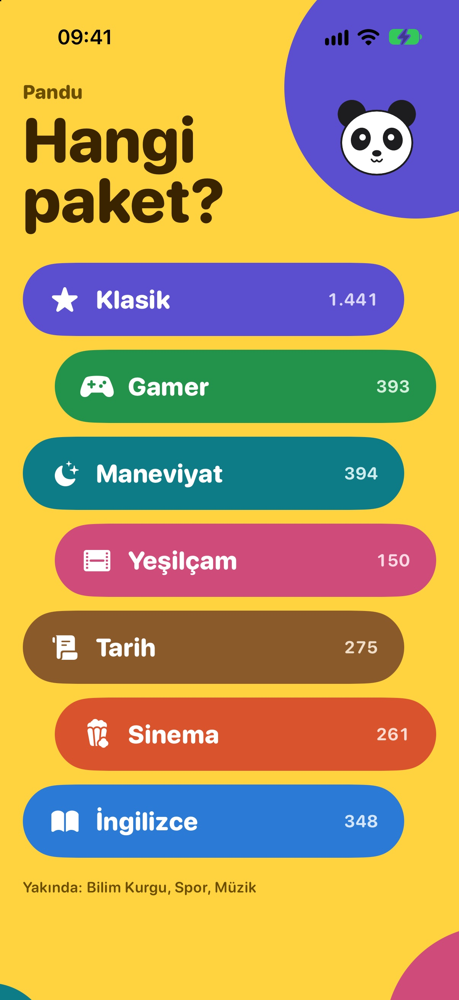
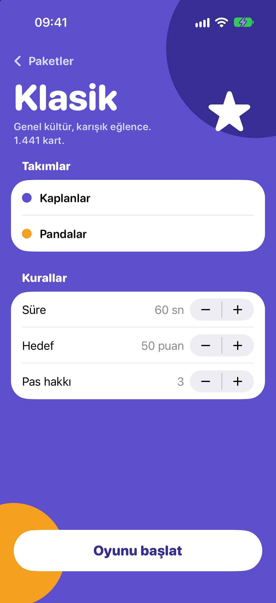
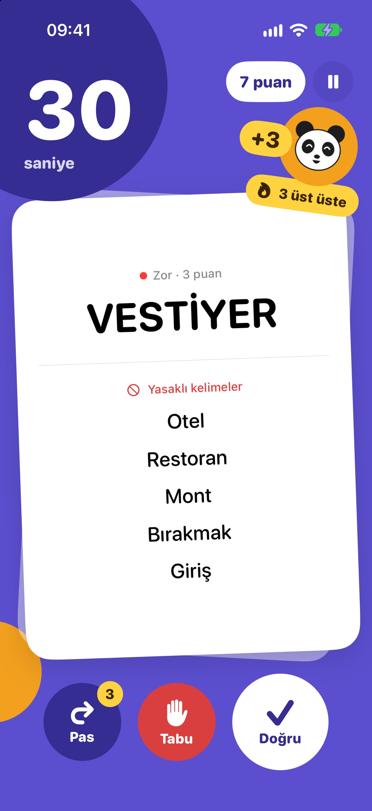
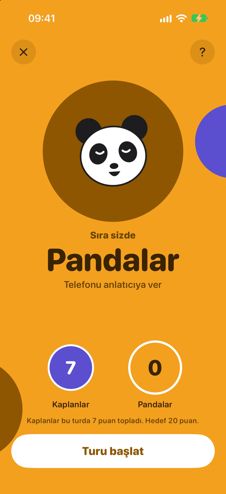
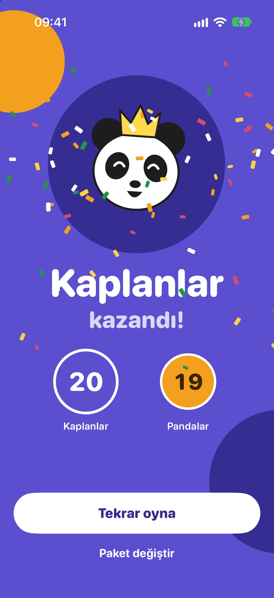

# 🚀 Pandu - Kelime Tahmin Oyunu - iOS


**Pandu (eski adıyla WordGuess)**, arkadaş ortamında iki takımla oynanan bir kelime anlatma (tabu) oyunudur. Anlatıcı karttaki kelimeyi, altındaki beş yasaklı kelimeyi söylemeden takımına anlatır; telefon turdan tura elden ele dolaşır. Uygulama tek cihazda, internetsiz çalışır ve tüm paketler ücretsizdir.

---

## ✨ Öne Çıkan Özellikler

* 📚 **3200'den fazla kart, 7 paket:**
  * **Klasik:** Genel kültür ve karışık kelimeler.
  * **Gamer:** Oyunlar, e-spor ve donanım terimleri.
  * **Maneviyat:** Manevi değerler ve Ramazan kültürü.
  * **Yeşilçam:** Eski Türk filmleri.
  * **Tarih:** Tarihi olaylar ve kişiler.
  * **Sinema:** Kült filmler ve dünya sineması.
  * **İngilizce:** Yasaklı kelimelerle dil pratiği.
  * *Yakında:* Bilim Kurgu, Spor, Müzik.
* ⚔️ **İki takım:** Takım adlarını siz verirsiniz. Her turun başında sıranın kimde olduğu ve skor büyükçe gösterilir; ekran sıradaki takımın rengine bürünür.
* 🃏 **Kaydırarak ya da düğmeyle oynama:** Kartı sağa atınca doğru, sola pas, aşağı tabu. Aynı üç eylem ekranın altındaki düğmelerde de var.
* 🎯 **Puanlama:** Kolay kart 1, orta 2, zor 3 puan. Tabu 1 puan götürür, pas puanı değiştirmez.
* 🐼 **Tepki veren panda:** Doğruda sevinir, tabuda şaşırır, molada uyur, kazanan takıma taç takar.
* 🔥 **Oyun hissi:** Kazanılan ve kaybedilen puan skorun yanından fırlar, üç doğrudan sonra seri sayacı çıkar, son on saniyede süre kırmızıya döner. Her eylemde titreşim ve ses vardır.
* ⚙️ **Ayarlar:** Tur süresi (30-120 sn), hedef skor (10-100) ve pas hakkı (0-10 ya da sınırsız). Ayarlar cihazda saklanır.
* ⏸ **Mola:** Duraklatınca kart gizlenir. Uygulama arka plana geçtiğinde oyun kendiliğinden duraklar.
* ♿ **Erişilebilirlik:** Sistem yazı boyutuna ve koyu moda uyar, düğmelerin VoiceOver etiketleri vardır, "Hareketi Azalt" açıkken konfeti ve yaylanma kapanır.

---

## 📸 Ekran Görüntüleri

| Paket Seçimi | Oyun Ayarları | Oyun Ekranı |
|---|---|---|
|  |  |  |

| Sıra Devri | Kazanan Ekranı |
|---|---|
|  |  |

---

## 🛠 Teknik Detaylar & Mimari

* **Mimari:** MVVM. Oyunun tüm durumu tek bir `GameViewModel` içinde tutulur; ekranlar `GameState` değerine göre değişir.
* **Arayüz:** Tamamı SwiftUI. Renkler ve yazı stilleri `Views/Theme.swift` içinde, arka plandaki daireler `Views/Decor.swift` içinde tanımlıdır.
* **Panda:** Hazır bir görsel değil; `Views/PandaView.swift` içinde `Canvas` ile çizilir, bu yüzden her boyutta nettir ve yüz ifadesi değişebilir.
* **Kart kaydırma:** `DragGesture` ile parmağı izler; karar kartın bırakıldığı yere değil, hızına göre varacağı yere bakılarak verilir.
* **Geri bildirim:** `UIFeedbackGenerator` ile titreşim, `AudioToolbox` ile sistem sesleri.
* **Veri:** Kartlar uygulamayla gelen JSON dosyalarından okunur (`Resources/`); ağ bağlantısı gerekmez.
* **Hedef:** iOS 17 ve üstü. iPhone'da yalnızca dikey kullanım, iPad desteklenir.

---

## 🚀 Kurulum & Çalıştırma

Projeyi kendi ortamınızda incelemek veya geliştirmek için aşağıdaki adımları izleyebilirsiniz:

1.  Bu depoyu bilgisayarınıza klonlayın:
    ```bash
    git clone https://github.com/aliyakarr9/WordGuess.git
    ```
2.  İndirdiğiniz klasördeki `WordGuess.xcodeproj` dosyasını çift tıklayarak **Xcode** (16 veya üstü) üzerinde açın.
3.  Üst menüden uygun bir **Simülatör** veya bilgisayarınıza bağlı gerçek bir **iOS cihazı** seçin.
4.  `Cmd + R` tuş kombinasyonuna basarak (veya Play butonuna tıklayarak) projeyi derleyip çalıştırın.

---

## 🤝 Katkıda Bulunma

Eğer kelime kütüphanesine yeni kelimeler eklemek, yeni kategoriler oluşturmak veya mevcut bir hatayı düzeltmek isterseniz:
1. Projeyi *fork* edin.
2. Yeni bir dal (branch) oluşturun (`git checkout -b feature/yeni-ozellik`).
3. Değişikliklerinizi commit edin (`git commit -m 'Yeni özellik eklendi'`).
4. Dalınıza (branch) push yapın (`git push origin feature/yeni-ozellik`).
5. Bir Pull Request (PR) oluşturun.

---

👨‍💻 **Geliştiren & Tasarlayan:** [Ali Yakar](https://github.com/aliyakarr9)  
📧 İletişim, işbirlikleri ve geri bildirim için GitHub üzerinden bana ulaşabilirsiniz.

> *"İyi bir oyun, sadece kurallarıyla değil, yaşattığı deneyimle akılda kalır."*
